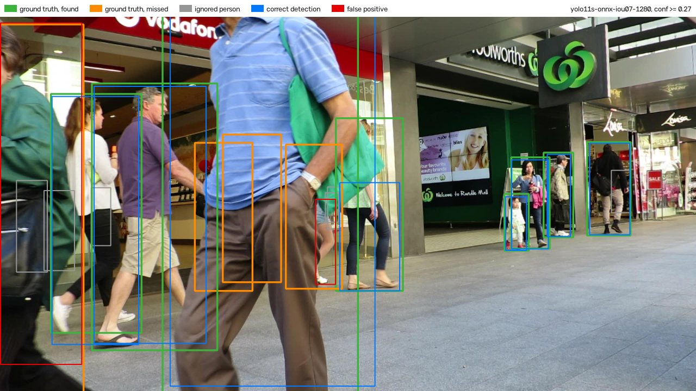
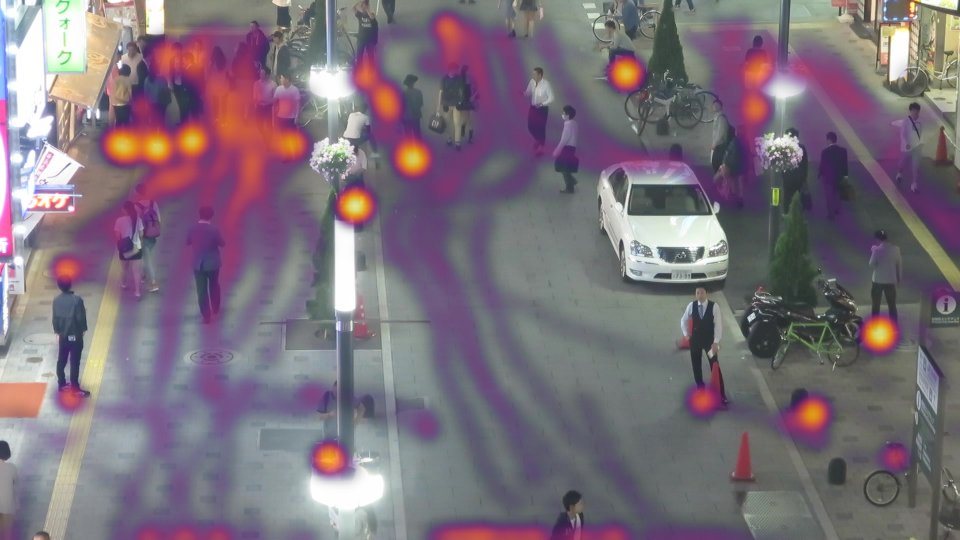

# Pedestrian detection and tracking on MOT17

Finds every pedestrian in a video, follows each one with a stable ID from frame to frame, and turns the tracks into numbers: how many people crossed a line in which direction, how many are in the scene, and where they walk. The tracker and the evaluation (AP, MOTA, IDF1) are written from scratch; the detector is a YOLO11 model, exported to ONNX and run without PyTorch in the live app. Every number below is measured on video sequences that were not used for any choice of model or setting.



## Data

[MOT17](https://motchallenge.net/data/MOT17/) is the standard benchmark for multi-object tracking: street scenes filmed with static and moving cameras, with a box and an ID for every pedestrian in every frame, including people who are hidden behind others (CC BY-NC-SA 3.0, not part of this repository). Only the seven training sequences have public ground truth. They are split by sequence, never by frame, because neighbouring frames are almost identical and a frame split would leak the validation scenes into training:

| split | sequences | frames | people | boxes |
|---|---|---|---|---|
| train | MOT17-04, -05, -11, -13 | 3,537 | 401 | 75,552 |
| validation | MOT17-02, -09, -10 | 1,779 | 145 | 36,745 |

38 % of the validation boxes are people who are less than 30 % visible, and MOT17-02 is full of small people far away ([reports/dataset.md](reports/dataset.md)). The 5.5 GB archive stores every sequence three times; `src/download.py` reads the archive's index over HTTP range requests and downloads only the 0.9 GB that is needed.

## Pipeline

| step | command | what it does |
|---|---|---|
| download | `make download` | MOT17 training sequences (frames, ground truth) |
| detect | `make detect` | runs COCO-pretrained YOLO11n/s at 640 and 1280 px, caches the person boxes |
| evaluate | `make evaluate` | AP with the MOTChallenge ignore rules, recall by visibility and box size |
| track | `make tracking` | tunes the tracker on the training sequences, runs it on validation, MOTA / IDF1 |
| fine-tune | `make finetune` | fine-tunes YOLO11n on the training sequences and compares |
| analytics | `make analytics` | line counting, crowd size, heatmaps |
| deploy | `make deploy` | ONNX export, check that the export loses nothing, speed on the Apple M1 |
| live app | `make live` | detect, track and count frame by frame on a video or webcam |

All settings are in `params.yaml`. Detections are cached in MOTChallenge format, so the tracker and the evaluation run in seconds without the detector.

## Results

**Detection** (validation, IoU 0.5, [reports/detection.md](reports/detection.md)):

| detector | input | AP50 | AP50:95 | recall, people < 50 px | recall, visibility < 0.3 | ms/frame (M1 GPU) |
|---|---|---|---|---|---|---|
| YOLO11n | 640 | 0.487 | 0.245 | 0.02 | 0.12 | 23 |
| YOLO11n | 1280 | 0.593 | 0.305 | 0.11 | 0.16 | 42 |
| YOLO11s | 1280 | **0.596** | **0.312** | 0.13 | 0.17 | 85 |
| YOLO11n fine-tuned on MOT17 | 1280 | 0.569 | 0.294 | 0.07 | 0.16 | 42 |

Input size matters more than model size: the nano model at 1280 px is as good as the small one and twice as fast. What every model misses are hidden people: 85 % of the fully visible people are found, but only 17 % of those that are mostly hidden.

**Tracking** (validation, 145 people, [reports/tracking.md](reports/tracking.md)):

| tracker | detector | MOTA | IDF1 | ID switches | track IDs |
|---|---|---|---|---|---|
| SORT style (Kalman + IoU, high-score boxes only, no memory) | YOLO11s | 0.415 | 0.406 | 321 | 456 |
| ByteTrack style, own implementation | YOLO11s | 0.445 | 0.446 | 228 | 250 |
| + filling gaps of up to 20 frames | YOLO11s | **0.450** | 0.450 | 230 | 250 |
| ByteTrack of the Ultralytics library, default settings | YOLO11s | 0.419 | 0.448 | 378 | 544 |

The own tracker is better than the library version and switches IDs 40 % less often. MOTA is held back by the detector: 17,500 of the 36,700 true boxes are not covered by any track, mostly the hidden people above.

**Counting** (static cameras, [reports/analytics.md](reports/analytics.md)): on MOT17-09 the counter counts 12 crossings for 12 real ones, with 92 % of the counted crossings matching a real crossing in direction and time. On MOT17-02 it finds only half of the crossings, because the small people far away are not detected.

**Speed** (Apple M1, 1920x1080 video, [reports/benchmark.md](reports/benchmark.md)):

| model | PyTorch CPU | PyTorch GPU (MPS) | ONNX Runtime CPU | ONNX Runtime Core ML |
|---|---|---|---|---|
| YOLO11n, 736x1280 | 96 ms | 44 ms | 104 ms | **31 ms** |
| YOLO11s, 736x1280 | 213 ms | 89 ms | 400 ms | 56 ms |

The live app (YOLO11n on Core ML, tracker, counter, drawing, writing the video) runs at 23 frames per second.



## How the decisions were made

**Evaluation first.** AP counts a detection on a person the benchmark ignores (static people, reflections, people on vehicles) neither as right nor wrong, as MOTChallenge does; without that, a good detector is punished for finding real people. MOTA and IDF1 are implemented in `src/track_metrics.py` because py-motmetrics no longer runs with NumPy 2. On the validation tracks both give identical numbers.

**Tracker.** A constant-velocity Kalman filter predicts where each person moves, the Hungarian algorithm matches predictions and boxes by overlap. The ByteTrack idea is a second matching round with the low-score boxes: a half-hidden person often gets a low score, and throwing those boxes away (as SORT does) breaks the track exactly when it gets hard. A track gets its ID only when it is confirmed in a second frame, so one-frame false alarms use no IDs. Three settings (score threshold, matching threshold, how long a lost track is kept) were tuned on the training sequences only, 24 combinations ([reports/tracker_tuning.md](reports/tracker_tuning.md)), and then run once on validation.

**Fine-tuning made it worse, and the reason is clear.** On held-out frames of the training sequences, mAP50 rose from 0.83 to 0.91 during 10 epochs. On the validation scenes, AP50 dropped from 0.593 to 0.569: better on MOT17-09 (0.72 to 0.77), worse on the many small people of MOT17-02. The training scenes contain mostly large people, and the 8 GB M1 could only train at 800 px, which shrinks the small people further. Four training scenes are too few to beat a detector trained on COCO's 64,000 images with people; the pretrained model stays the default.

**Export check.** The ONNX models run with own pre- and post-processing (letterbox, decoding, non-maximum suppression) and give the same AP as PyTorch to three decimals (one box in 55,000 differs). A looser suppression threshold (0.7 instead of 0.5) keeps more overlapping people (AP50 0.607 instead of 0.593 for YOLO11n) but did not improve tracking (MOTA 0.443, IDF1 0.458), so 0.5 stays.

**Counting.** The feet position (bottom centre of the box) is smoothed over 5 frames; a crossing back within 15 frames cancels both. The same counter runs on the ground-truth paths, and a counted crossing is only correct if a real person crossed in the same direction within 15 frames. The total alone can be right by luck.

## Run it

Python 3.11, about 3 GB of disk for data and packages.

```bash
python -m venv .venv && source .venv/bin/activate
pip install -r requirements.txt
make download            # 0.9 GB from motchallenge.net
make detect evaluate     # detection baseline
make tracking            # tracker tuning and results
make analytics           # counting, crowd size, heatmaps
make export benchmark    # ONNX export and speed
make test lint           # 42 tests, ruff
```

The live app works on any video file, an image sequence or a webcam:

```bash
python -m src.app my_video.mp4 --line 0 600 1920 600 --out out.mp4
python -m src.app 0 --show
```

The line goes from point (x1, y1) to (x2, y2) in pixels; for a line drawn from top to bottom, walking from right to left counts as "in". The app prints the counts and the frame rate at the end.

## Project structure

```
src/
  download.py, remote_zip.py      partial download of the MOT17 archive
  mot.py, stats.py                MOTChallenge files, dataset overview
  detect.py, evaluate_det.py      cached detections, AP evaluation (metrics.py)
  kalman.py, tracker.py           Kalman filter, ByteTrack-style tracker
  track.py, track_metrics.py      tuning and experiments, MOTA / IDF1
  evaluate_track.py               tracking report
  reference_track.py              library ByteTrack for comparison
  prepare_yolo.py, train.py       fine-tuning data and training
  analytics.py, render.py         counting, crowd size, heatmaps, demo video
  onnx_detector.py, deploy.py     ONNX Runtime detector, export, benchmark
  app.py                          live pipeline
tests/                            42 tests
reports/                          all results as Markdown and JSON, figures
```

## Limitations and next steps

- Hidden people are the main source of errors. A detector trained on crowded scenes (CrowdHuman) would help more than any tracker setting.
- There is no appearance model: two people who cross paths can swap IDs. Re-identification features (as in DeepSORT or BoT-SORT) are the next step.
- On a moving camera the Kalman filter predicts in image coordinates; camera-motion compensation would reduce ID switches on MOT17-10, which has the most.
- Fine-tuning at the full 1280 px with crowded-scene data, on a machine with more memory.
- Counting was checked on three static scenes with 12 to 21 crossings each, too few for precise error rates.

## Credits

MOT17 by Milan et al., [MOT16: A Benchmark for Multi-Object Tracking](https://arxiv.org/abs/1603.00831) (CC BY-NC-SA 3.0); the frames in `reports/figures` come from it. YOLO11 by [Ultralytics](https://github.com/ultralytics/ultralytics) (AGPL-3.0). The tracker follows the ideas of SORT (Bewley et al., 2016) and ByteTrack (Zhang et al., 2022).
